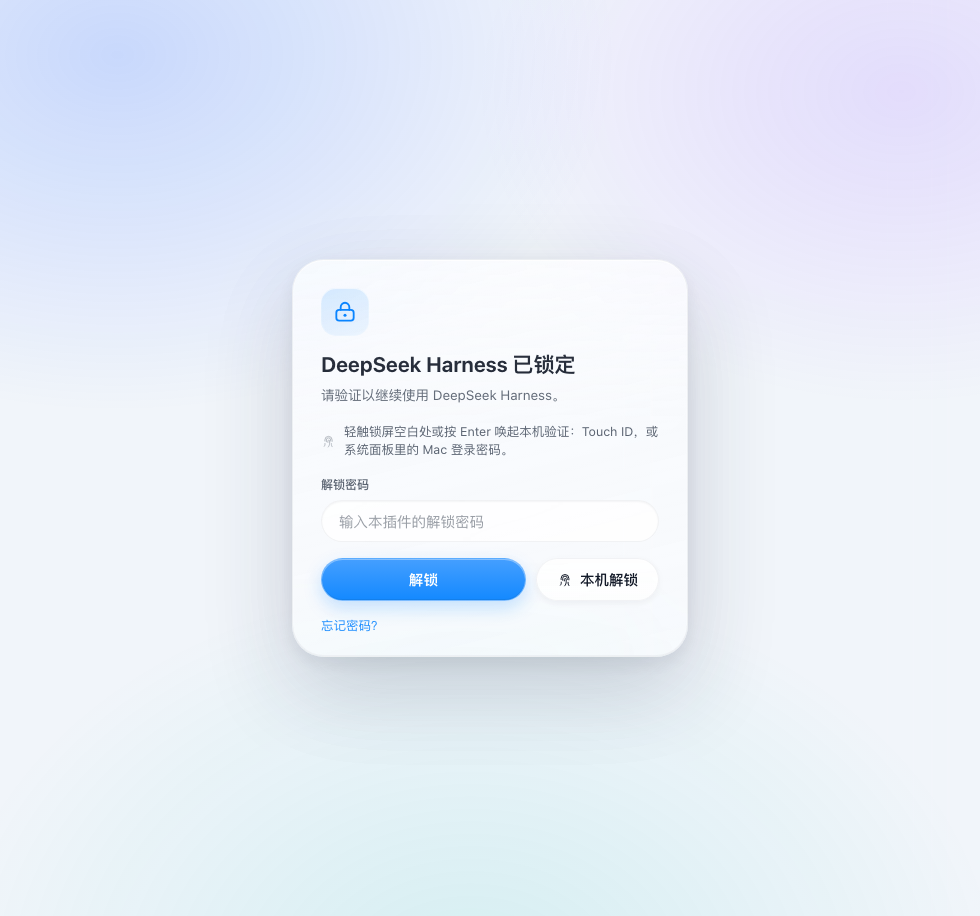

# dsh-lock · DSH 锁屏 / 本机指纹·密码解锁

[](https://github.com/SeyanaA/dsh-lock/actions/workflows/test.yml)
[](https://github.com/SeyanaA/dsh-lock/releases)

> 最新版本 **v0.1.8**（macOS 26 Liquid Glass 风格）。
> 下载：[Releases](https://github.com/SeyanaA/dsh-lock/releases) · 预览：[`docs/preview-lock.png`](./docs/preview-lock.png)



给 [DeepSeek Harness](https://github.com/deepseek-ai) Desktop 用的**本地锁屏插件**（macOS，
建议 MacBook 且支持 Touch ID）：

- **每次启动 DSH**：需要重新验证（插件解锁密码，或**本机指纹 / Mac 登录密码**）；
- **48 小时未验证**：下一次打开 / 状态轮询时重新锁定；
- **首次访问**：强制设置解锁密码（**至少 4 位，内容不限**，任何字符都可以）；
- **本机指纹 / 密码解锁**：点「本机解锁」或轻触锁屏空白处 / 按一次 Enter 后，由 **macOS
  系统面板**完成验证——可以放手指用 **Touch ID**，也可以直接输入 **Mac 登录密码**回退。
  > 这是**本机（macOS 账户）验证**，不是插件自己的解锁密码；两者互相独立。因为系统面板里
  > 究竟用了指纹还是 Mac 密码，插件无法得知，所以按钮、成功动画与提示统一标注为
  > **「本机解锁」**，不会声称「指纹验证通过」。
  > 另外 macOS 不向第三方应用开放“后台监听 Touch ID 传感器”的能力，验证必须经系统面板
  > 完成，这是 Apple 的安全设计；所以无法做到“手指一放就检测、完全零交互”。
- **液态玻璃（Liquid Glass）视觉**：按 Apple HIG “Materials”与 macOS 26 控制层规范重做——
  胶囊形输入框与按钮（参考 macOS 搜索框）、半透明玻璃材质 + 背景模糊/饱和度增强、
  细高光边与柔和内阴影、仅主操作使用强调色（系统蓝 #0A84FF）、深浅色主题自适应；
  预览图见 [`docs/preview-lock.png`](./docs/preview-lock.png)。
- **解锁动画**：**本机解锁**（指纹或 Mac 登录密码）= 绿色柔光 + 指纹淡出 + 对勾描边，
  文案为「本机解锁成功」；**插件解锁密码** = 蓝色柔光 + 锁扣弹开 + 对勾描边，文案为
  「解锁密码通过」；随后玻璃面板淡出；
- **忘记密码**：终端执行一条命令，密码恢复为默认密码 **4396**，重新打开 DSH 输入 4396
  解锁，再到设置里修改；
- **右上角一键锁定**：会话头部右侧工具区新增锁形按钮，点击立即锁定并呼出锁屏；
- **独立应用锁（可选，默认关闭）**：在 `设置 → 安全锁定` 里单独开启后，**只认插件解锁密码**——
  本机指纹与 Mac 登录密码都不再能打开 DSH。适合你希望 DSH 里的生产内容与对话记录跟
  Mac 登录凭据隔离：即使别人知道你的 Mac 密码、或能通过指纹验证，也打不开这里。
  默认不开启：这时按 macOS 的常规语义，Touch ID / Mac 登录密码即为机主授权。
- **配置入口**：`设置 → 安全锁定`（修改解锁密码、开关本机解锁、开关独立应用锁、立即锁定、查看重置命令）。

数据全部在本机：密码只以 scrypt 哈希形式保存在 `~/.dsh/dsh-lock/state.json`（权限 600），
不读取任何会话内容，不发起网络请求。

> A local lock screen for DeepSeek Harness Desktop on macOS: re-authenticate after every
> restart or 48 hours with a 4+ character plugin password or a **local device unlock**
> (Touch ID *or* the Mac login password, via LocalAuthentication — labelled 本机解锁 in the
> UI). Settings live under Settings → 安全锁定.

---

## 环境要求

- **macOS**（在 macOS 27 / Apple Silicon 上验证）；录入 Touch ID 的 MacBook 可以指纹解锁，
  系统面板也接受 Mac 登录密码；没有 Touch ID 的 Mac 可以只用插件解锁密码；
- **DeepSeek Harness Desktop ≥ 0.2.0-rc.1**；
- 本机解锁由插件自带的原生小助手（`bin/dsh-auth-helper`，Swift + LocalAuthentication，
  `deviceOwnerAuthentication` 策略）实现，预编译为 arm64；Intel Mac 可执行
  `scripts/build-helper.sh` 重新编译（需要 Xcode Command Line Tools）。

## 安装

插件以「本地 bundle」形式装进 DSH 的 profile（默认 `desktop`）。

### 方式一：让 DSH 里的 Agent 安装（推荐）

1. 把仓库放到固定目录（安装后不要移动；也可以用 Release 里的 zip 解压）：

   ```bash
   git clone https://github.com/SeyanaA/dsh-lock.git ~/dsh-lock
   ```

2. 在 DSH 里新开对话，对 Agent 说：

   > 把 `/Users/你的用户名/dsh-lock` 作为本地插件安装到当前 profile。

3. 如果界面没有立刻变化，**完全退出并重新打开** DeepSeek Harness。

### 方式二：手动安装

1. 把插件目录放到例如 `~/.dsh/local-plugins/dsh-lock`；
2. 编辑 `~/.dsh/profiles/desktop/package.json`：
   - `dependencies` 添加 `"dsh-lock": "link:/Users/你的用户名/.dsh/local-plugins/dsh-lock"`；
   - `dsh.profile.bundles` 追加 `"dsh-lock"`；
3. 在 profile 目录执行 `pnpm install`（或 DSH 自带 pnpm），重启 DSH。

## 使用

### 首次访问

安装并重新打开 DSH 后，界面会被锁屏覆盖：**设置解锁密码**（至少 4 位，内容不限，这是
插件自己的解锁密码，与 Mac 登录密码无关）。如果这台 Mac 支持并已录入 Touch ID，插件会
**自动启用本机解锁**（可在 设置 → 安全锁定 中关闭），设置完成后即解锁。

### 日常解锁

锁屏出现后（不会自己弹任何窗口）：

- 轻触锁屏空白处，或按一次 Enter，或点一下 **「本机解锁」** → macOS 系统验证面板出现；
  把手指放上去用 **Touch ID** 即解锁，也可以在面板里选择输入 **Mac 登录密码**（这**不是**
  插件的解锁密码）；
- 也可以直接在输入框里填**插件解锁密码** + 回车解锁；
- 如果取消了系统面板，可以再次轻触 / 按 Enter / 点「本机解锁」重新唤起，或改用解锁密码。

锁定触发条件：

| 条件 | 说明 |
| --- | --- |
| 每次启动 DSH | 进程启动即锁定 |
| 48 小时未验证 | 已解锁状态超过 48 小时，自动重新锁定 |
| 手动锁定 | 设置 → 安全锁定 → 立即锁定 |

### 一键锁定

DSH 会话头部右上角有一个锁形按钮（在模型/搜索等工具的最右侧）：点击它会立即锁定，
锁屏随即覆盖界面；随后轻触锁屏 / 按 Enter / 点「本机解锁」唤起系统验证。也可以从
`设置 → 安全锁定 → 立即锁定` 锁定。

### 忘记密码（强制恢复默认密码 4396）

在**终端**执行插件自带的重置命令：

```bash
~/.dsh/local-plugins/dsh-lock/bin/reset-password
```

（如果插件装在别的路径，可在 `设置 → 安全锁定 → 忘记密码` 里看到实际命令。）

执行后会提示“已恢复默认密码：4396”。回到 DSH（或重新打开 DSH），锁屏会要求输入密码，
输入 **4396** 解锁；解锁后请到 `设置 → 安全锁定` 修改为你自己的密码。

> 重置命令只改写插件自己的 `~/.dsh/dsh-lock/state.json`，不会动 DSH profile、会话或任何
> 其它数据；原状态文件会先备份为 `state.json.bak-时间戳`。

### 设置页

`设置 → 安全锁定`：

- 查看锁定规则、当前会话状态、上次验证时间、解锁密码是否为默认密码、本机解锁与独立应用锁状态；
- 修改解锁密码（当前密码 + 新密码 ≥ 4 位）；
- 开关本机解锁（指纹 / Mac 登录密码；需要当前会话已解锁，且本机可用；独立应用锁开启时不可用）；
- 开关独立应用锁（开启后只认插件解锁密码，本机验证不会解锁）；
- **立即锁定**；
- **忘记密码** 的重置命令。

## 忘记密码 / 重置流程（示意）

```text
$ ~/.dsh/local-plugins/dsh-lock/bin/reset-password
已恢复默认密码：4396
文件：/Users/you/.dsh/dsh-lock/state.json
现在重新打开 DSH（或切回 DSH 窗口），输入 4396 解锁；
解锁后请到 设置 → 安全锁定 修改为自己的密码。
```

## 独立应用锁（可选）

默认情况下，本机验证即机主授权：能过 Touch ID / Mac 登录密码，就能解锁本插件。

如果你希望 **DSH 里的生产内容与对话记录**不跟着 Mac 凭据走，可在
`设置 → 安全锁定` 里开启 **独立应用锁**：

- 开启后只接受**插件解锁密码**；「本机解锁」按钮隐藏，`/biometric` 路由也会拒绝；
- 本机指纹开关会被停用（配置保留，关闭独立应用锁后可恢复）；
- 忘记密码仍可用终端重置命令恢复默认密码 **4396**——独立应用锁保持开启，
  不会因为重置被悄悄关掉；
- 关闭独立应用锁需要当前会话已解锁（和修改密码、开关本机解锁一样）。

> 安全边界要说清楚：重置命令依赖“能在这台机器上执行命令”，这是本地恢复路径；
> 独立应用锁挡的是应用层与 Mac 凭据的越权，不是磁盘取证。要防后者请开 FileVault。

## 故障排查

- **一直显示“正在读取锁定状态”**：说明插件宿主没有加载。重启 DSH；若仍不行，让 Agent
  移除 `dsh-lock` bundle（或手动从 profile 删除）后重启。
- **被锁住但暂时不想设置密码**：在终端执行重置命令（见上），然后输入默认密码 **4396**。
- **「本机解锁」点了没反应**：确认本机已录入指纹、系统设置里“使用触控 ID 解锁”已开启；
  到 `设置 → 安全锁定` 确认「本机解锁」为“已启用”。系统面板本身也允许回退到 Mac 登录密码
  （与插件解锁密码不同）。

## 安全设计（含安全审核要点）

**入口与认证**

- 锁屏出现时**不主动弹出**任何系统验证窗口，只在用户明确手势后调用 `LocalAuthentication`；
- 默认允许本机验证解锁——这与 macOS 的一致语义相符：能通过 Touch ID 或系统密码的人，
  本来就能操作这台 Mac（装软件、看钥匙串），本插件不额外制造边界；
- 需要更强边界时开启 **独立应用锁**：插件只接受自己的解锁密码，`/biometric` 路由直接拒绝
  本机验证（返回 409），界面上也不再提供「本机解锁」；此时即使知道 Mac 密码也打不开 DSH；
- 本机验证（指纹或 Mac 登录密码）完全由 macOS 系统面板执行，插件不接触、不存储任何
  指纹或密码数据，只收到“成功 / 失败”；
- 系统面板允许回退到 Mac 登录密码（`deviceOwnerAuthentication` 语义，与系统一致）；因此
  成功提示统一写「本机解锁成功」，不会误报为指纹验证；
- 密码 → scrypt（随机盐，Node `crypto`）+ 常数时间比较（`timingSafeEqual`），只保存哈希；
- 密码长度下限 4 位、上限 256 位；连续错误 5 次后进入 30 秒起、逐级翻倍的冷却；
- 状态文件权限 `0600`，仅存哈希/时间戳，不含密码与会话内容。

**HTTP 面（本地路由）**

- 所有会改变状态的接口（setup/unlock/lock/password/biometric/report）都要求：
  `content-type: application/json` + 客户端标记头 `x-dsh-lock-client: 1` +
  同源 `Origin`（非本 DSH 源直接 403）+ 拒绝 `Sec-Fetch-Site: cross-site`；
  这样普通网页 / DNS-rebinding 无法锁定界面或刷指纹弹窗；
- 本机解锁唤起有节流：1.5 秒内最多一次、每分钟最多 5 次，避免弹窗轰炸；
- 响应带 `Cache-Control: no-store`、`X-Content-Type-Options: nosniff`；
- 请求体限制 16KB。

**已知边界**

- 这是**应用内 UI 锁**（防止旁人查看 DSH 内容），不是磁盘加密或系统账户保护；
- 能登录你的 macOS 账户、且能在终端操作的人可以重置状态文件绕过锁屏——这是找回密码的
  设计代价（恢复命令本身也依赖本机账户权限）；
- DSH 的其它本地接口不在本插件保护范围内。

## 卸载

- 让 Agent 调用 `plugin_manager` 的 `remove_bundle`（target：`dsh-lock`）；或
- 手动删除 profile `package.json` 中 `dsh-lock` 的两处引用并 `pnpm install`，重启 DSH；
- 需要的话再删除状态目录：`rm -rf ~/.dsh/dsh-lock`。

## 开发与测试

```bash
node test/run.mjs
```

- `test/host-lock.mjs`：首次设置、解锁、错误次数锁定、48 小时重锁、重启锁定、改密码、
  默认密码 4396 重置等状态机逻辑；
- `test/client-render.mjs`：mock ModuleLoader/React 下验证 `shell.overlay` 与
  `settings.section` 注册、锁屏各模式、设置页内容与上报。

重新编译本机验证小助手（需要 Xcode Command Line Tools）：

```bash
./scripts/build-helper.sh
./bin/dsh-auth-helper --check   # 输出 available 表示本机可用
```

## License

[MIT](./LICENSE) © 2026 SeyanaA
